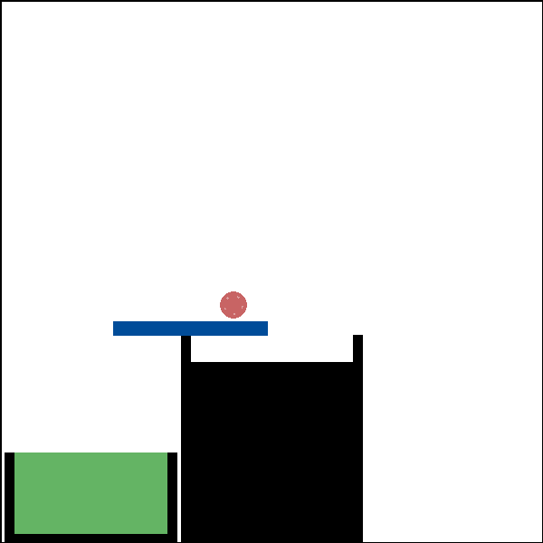

# Worked two-attempt interaction

This is a measured GPT-5 full-feedback episode (seed 2026), not an illustrative example.
Task: `0398_FallingAlt_6_downward__goal_0052`. Goal: **blue plank ends touching orange ball tool and partially inside the green container**.

Source: [`data/finalized/gpt5/units-0002.jsonl.gz`](../data/finalized/gpt5/units-0002.jsonl.gz); select the JSONL record whose `summary.goal.balanced_goal_id` equals the task ID above.
The tool accelerates downward; the valid-attempt budget is eight. Each candidate starts from the same initial world.



| Attempt | Placement | Binary success | Prospective chosen-action PQ |
|---|---|---:|---:|
| 1 | `[250, 520]` | 0 | 0.773672 |
| 2 | `[160, 520]` | 1 | 0.665068 |

PQ is the equally weighted mean across the four scored dynamic objects of the Gaussian endpoint score with sigma = 150 pixels. Matching exit states/sides receive one; mismatches receive zero. Action is scored as binary goal success.
The following user prompts and response texts are copied from the released provider-call records. Predictions were made before observing the corresponding rollout.

## Attempt 1

The request supplied the unchanged initial image.
Rendered user-prompt SHA-256: `dae54c0c1e0a17a99b23b98f9bd9510e249cda30193ebe290d525fd2f0fb2aee`.

```text
Goal: blue plank ends touching orange ball tool and partially inside the green container

You may be asked for up to 8 valid candidate placements. Each candidate is simulated independently from the same initial scene. The experimenter controls whether another candidate is requested and what evidence is supplied, so continuation alone does not reveal the preceding outcome.

The first attached image is the static initial scene.

The environment uses a 600 x 600 coordinate space:
- Coordinates are integer pixels in the range 0-599.
- The origin (0,0) is at the bottom-left corner.
- The x coordinate increases from left to right.
- The y coordinate increases from bottom to top.
- Black objects are fixed and cannot be moved.
- The red ball and all blue objects are movable.
- The green goal container is movable.
- You may drop one orange ball tool with diameter 72 pixels.
- After placement, the orange tool is released and accelerates downward, as do the other movable objects.
- Choose a center point where the whole orange ball fits.
- Do not choose a placement that overlaps an existing object or scene boundary.

Interaction context:
- Your earlier action coordinates and coordinate predictions remain in the text conversation.
- Any success/failure labels revealed by this condition remain in the text conversation.
- Rollout media do not persist. On a continuation turn, only the latest rollout's 32 images or 32 JSON states are supplied.

Before seeing the rollout, predict the terminal state of every listed movable object:
- id "Ball": red ball (Ball)
- id "Goal": green container (Container)
- id "Support": blue plank (Poly)
- id "PLACED": orange ball tool (Ball)

For an object remaining in the scene, use {"id":"...","state":"in_scene","point":[x,y],"orientation_deg":number_or_null}.
For an object that exits, use {"id":"...","state":"exited","exit_side":"left|right|top|bottom","point":null,"orientation_deg":null}.
Use orientation_deg only when meaningful for a non-circular object; otherwise use null.

Return exactly one JSON object:
{"action":"drop","point":[x,y],"coordinate_predictions":[...one entry for every id above...],"reasoning":"<brief reasoning>"}
```

Model response:

```json
{"action":"drop","point":[250,520],"coordinate_predictions":[{"id":"Ball","state":"in_scene","point":[300,200],"orientation_deg":null},{"id":"Goal","state":"in_scene","point":[110,70],"orientation_deg":0},{"id":"Support","state":"in_scene","point":[170,180],"orientation_deg":-30},{"id":"PLACED","state":"in_scene","point":[140,120],"orientation_deg":null}],"reasoning":"Dropping the large orange ball onto the mid/right of the blue plank should knock the red ball away and force the plank to tip off its support, with the left side dropping into the green container. The plank is likely to settle against the orange ball while partly inside the green container."}
```

| Object | Predicted center | Observed center | Center error |
|---|---|---|---:|
| `Ball` (red ball) | [300.0, 200.0] | [375.0, 215.0] | 76.5 px |
| `Goal` (green goal container) | [110.0, 70.0] | [100.0, 53.4] | 19.4 px |
| `PLACED` (big orange ball (dropped tool)) | [140.0, 120.0] | [328.7, 235.8] | 221.4 px |
| `Support` (blue plank) | [170.0, 180.0] | [217.5, 235.3] | 72.9 px |

Simulator goal success: **false**. Prospective PQ: **0.773672**.

## Attempt 2

The request supplied the unchanged initial image and 32 uniformly sampled frames from the preceding failed rollout.
Rendered user-prompt SHA-256: `98972525d45bdc75fd4f7612a1427cab5916c9cc6e03b7a7283cbabc56231eae`.

```text
Latest recorded candidate:
- Attempt 1 was recorded at placement [250, 520].
- Goal: blue plank ends touching orange ball tool and partially inside the green container
- The first attached image is the unchanged static initial scene.
- The next 32 attached images are uniformly sampled frames from only the latest rollout, ordered early to late.
- Simulator result: the previous placement did not satisfy the goal.


You have 7 valid candidate placements remaining. Continuation does not by itself reveal the previous result. Use the information available in the conversation to submit a distinct next candidate.

Before seeing the rollout, predict the terminal state of every listed movable object:
- id "Ball": red ball (Ball)
- id "Goal": green container (Container)
- id "Support": blue plank (Poly)
- id "PLACED": orange ball tool (Ball)

For an object remaining in the scene, use {"id":"...","state":"in_scene","point":[x,y],"orientation_deg":number_or_null}.
For an object that exits, use {"id":"...","state":"exited","exit_side":"left|right|top|bottom","point":null,"orientation_deg":null}.
Use orientation_deg only when meaningful for a non-circular object; otherwise use null.

Return exactly one JSON object:
{"action":"drop","point":[x,y],"coordinate_predictions":[...one entry for every id above...],"reasoning":"<brief reasoning>"}
```

Model response:

```json
{"action":"drop","point":[160,520],"coordinate_predictions":[{"id":"Ball","state":"in_scene","point":[360,260],"orientation_deg":null},{"id":"Goal","state":"in_scene","point":[110,70],"orientation_deg":0},{"id":"Support","state":"in_scene","point":[150,200],"orientation_deg":-25},{"id":"PLACED","state":"in_scene","point":[120,120],"orientation_deg":null}],"reasoning":"Dropping the orange tool onto the left side of the blue plank should drive that end down so the plank tips left and drops partially into the green container, settling while pressing against the orange ball. The red ball likely rolls off right toward the black container area."}
```

| Object | Predicted center | Observed center | Center error |
|---|---|---|---:|
| `Ball` (red ball) | [360.0, 260.0] | [437.2, 16.0] | 255.9 px |
| `Goal` (green goal container) | [110.0, 70.0] | [100.5, 53.4] | 19.1 px |
| `PLACED` (big orange ball (dropped tool)) | [120.0, 120.0] | [52.6, 46.8] | 99.5 px |
| `Support` (blue plank) | [150.0, 200.0] | [109.5, 62.3] | 143.5 px |

Simulator goal success: **true**. Prospective PQ: **0.665068**.

## What this example establishes

The first placement failed (PQ 0.774); after visual feedback and a failure label, the second succeeded (PQ 0.665). In this episode, a successful revised action had a less accurate endpoint prediction. This is an example of the distinction between action and prediction, not an estimate of an average feedback effect.
The full-feedback branch stopped after attempt 2. Earlier action/prediction text remained in the conversation; only the latest rollout media were supplied on the next turn. The complete provider calls, image hashes, attempted placements and simulator endpoints remain in the linked model record.
See the [prompt and stopping protocol](../prompts/README.md).
